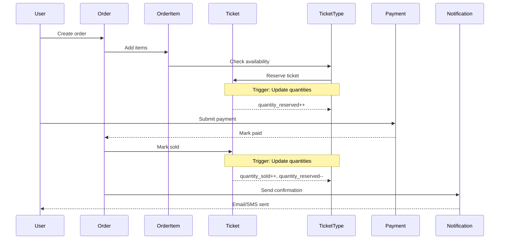

# OneStage Database ERD (Entity Relationship Diagram)

> **Production Schema v1.0**  
> UUID Primary Keys + Complete Relationships  
> Last Updated: 2026-08-25

## Entity Relationship Diagram

```mermaid
erDiagram
    %% USERS & AUTHENTICATION
    users ||--o{ user_login_history : "has login history"
    
    %% EVENTS & VENUES
    venues ||--o{ events : "hosts"
    users ||--o{ events : "organizes"
    events ||--o{ event_history : "has history"
    users ||--o{ event_history : "changed by"
    events ||--o{ users_events : "has staff"
    users ||--o{ users_events : "assigned as staff"
    users ||--o{ users_events : "assigned by"
    
    %% TICKETS & INVENTORY
    events ||--o{ ticket_types : "has types"
    ticket_types ||--o{ tickets : "instances"
    events ||--o{ tickets : "for event"
    orders ||--o{ tickets : "purchased in"
    users ||--o{ tickets : "owns"
    users ||--o{ tickets : "checked in by"
    tickets ||--o{ ticket_check_in_history : "has check-ins"
    events ||--o{ ticket_check_in_history : "at event"
    users ||--o{ ticket_check_in_history : "user"
    users ||--o{ ticket_check_in_history : "checked in by"
    
    %% ORDERS & PAYMENTS
    users ||--o{ orders : "places"
    events ||--o{ orders : "for event"
    orders ||--o{ order_items : "contains"
    ticket_types ||--o{ order_items : "ordered"
    tickets ||--o{ order_items : "specific ticket"
    orders ||--o{ order_history : "has history"
    users ||--o{ order_history : "changed by"
    orders ||--o{ payments : "paid by"
    
    %% QUEUE MANAGEMENT
    events ||--o{ waiting_queues : "has queue"
    users ||--o{ waiting_queues : "in queue"
    waiting_queues ||--o{ queue_history : "tracked by"
    events ||--o{ queue_history : "for event"
    users ||--o{ queue_history : "user"
    
    %% NOTIFICATIONS
    users ||--o{ notifications : "receives"
    
    %% REVIEWS & RATINGS
    events ||--o{ event_reviews : "reviewed"
    users ||--o{ event_reviews : "wrote review"
    orders ||--o{ event_reviews : "verified from"
    
    %% AUDIT
    users ||--o{ audit_trail : "performed action"
    
    %% ENTITY DEFINITIONS
    
    users {
        VARCHAR36 user_id PK "UUID"
        VARCHAR50 username UK "Unique username"
        VARCHAR255 email UK "Unique email"
        VARCHAR36 cognito_sub UK "Cognito immutable user ID; nullable for legacy users"
        VARCHAR100 first_name
        VARCHAR100 last_name
        VARCHAR20 phone_number
        DATE date_of_birth
        ENUM status "active/suspended/deleted"
        BOOLEAN email_verified
        BOOLEAN phone_verified
        TIMESTAMP created_at
        TIMESTAMP updated_at
        TIMESTAMP last_login_at
    }
    
    user_login_history {
        VARCHAR36 login_id PK "UUID"
        VARCHAR36 user_id FK
        TIMESTAMP login_time
        VARCHAR45 ip_address
        TEXT user_agent
        VARCHAR50 device_type
        ENUM login_status "success/failed/blocked"
        VARCHAR255 failure_reason
        VARCHAR255 session_id
        TIMESTAMP logout_time
    }
    
    users_events {
        VARCHAR36 user_event_id PK "UUID"
        VARCHAR36 event_id FK
        VARCHAR36 user_id FK
        ENUM role "admin/helper"
        VARCHAR36 assigned_by_user_id FK
        TIMESTAMP assigned_at
        ENUM status "active/revoked"
    }
    
    venues {
        VARCHAR36 venue_id PK "UUID"
        VARCHAR255 venue_name
        VARCHAR500 address
        VARCHAR100 city
        VARCHAR100 state
        VARCHAR100 country
        VARCHAR20 postal_code
        INT capacity
        ENUM venue_type "indoor/outdoor/virtual/hybrid"
        VARCHAR255 contact_email
        VARCHAR20 contact_phone
        DECIMAL latitude "10,8"
        DECIMAL longitude "11,8"
        ENUM status "active/inactive/maintenance"
        TIMESTAMP created_at
        TIMESTAMP updated_at
    }
    
    events {
        VARCHAR36 event_id PK "UUID"
        VARCHAR255 event_name
        TEXT event_description
        ENUM event_type "concert/sports/theater/conference/festival/other"
        VARCHAR36 venue_id FK
        VARCHAR36 organizer_id FK "References users"
        TIMESTAMP event_start_datetime
        TIMESTAMP event_end_datetime
        TIMESTAMP doors_open_time
        VARCHAR20 age_restriction
        VARCHAR100 dress_code
        ENUM status "draft/published/cancelled/postponed/completed"
        TEXT cancellation_reason
        INT total_capacity
        BOOLEAN featured
        VARCHAR500 banner_image_url
        VARCHAR500 thumbnail_image_url
        TEXT terms_conditions
        TIMESTAMP created_at
        TIMESTAMP updated_at
        TIMESTAMP published_at
    }
    
    event_history {
        VARCHAR36 history_id PK "UUID"
        VARCHAR36 event_id FK
        VARCHAR36 changed_by_user_id FK
        ENUM change_type "created/updated/published/cancelled/postponed"
        VARCHAR100 field_changed
        TEXT old_value
        TEXT new_value
        TIMESTAMP changed_at
        VARCHAR45 ip_address
        TEXT notes
    }
    
    ticket_types {
        VARCHAR36 ticket_type_id PK "UUID"
        VARCHAR36 event_id FK
        VARCHAR100 type_name
        TEXT type_description
        DECIMAL price "10,2"
        INT quantity_total
        INT quantity_available
        INT quantity_sold
        INT quantity_reserved
        INT max_per_order
        TIMESTAMP sale_start_datetime
        TIMESTAMP sale_end_datetime
        ENUM status "active/sold_out/inactive"
        VARCHAR50 seating_section
        TIMESTAMP created_at
        TIMESTAMP updated_at
    }
    
    tickets {
        VARCHAR36 ticket_id PK "UUID"
        VARCHAR36 ticket_uuid UK "UUID"
        VARCHAR36 event_id FK
        VARCHAR36 ticket_type_id FK
        VARCHAR36 order_id FK
        VARCHAR36 user_id FK
        VARCHAR100 ticket_code UK
        VARCHAR500 qr_code_url
        VARCHAR50 seat_number
        ENUM status "available/reserved/sold/used/cancelled/refunded"
        DECIMAL price_paid "10,2"
        TIMESTAMP issued_at
        TIMESTAMP used_at
        TIMESTAMP checked_in_at
        VARCHAR36 checked_in_by_user_id FK
        TIMESTAMP created_at
        TIMESTAMP updated_at
    }
    
    ticket_check_in_history {
        VARCHAR36 check_in_id PK "UUID"
        VARCHAR36 ticket_id FK
        VARCHAR36 event_id FK
        VARCHAR36 user_id FK
        VARCHAR36 checked_in_by_user_id FK
        TIMESTAMP check_in_time
        ENUM check_in_method "qr_scan/manual/nfc/barcode"
        TEXT device_info
        VARCHAR50 location_gate
        VARCHAR45 ip_address
        ENUM status "success/failed/duplicate/invalid"
        VARCHAR255 failure_reason
    }
    
    orders {
        VARCHAR36 order_id PK "UUID"
        VARCHAR50 order_number UK
        VARCHAR36 user_id FK
        VARCHAR36 event_id FK
        ENUM order_status "pending/confirmed/processing/completed/cancelled/refunded"
        ENUM payment_status "pending/paid/failed/refunded/partial_refund"
        DECIMAL total_amount "10,2"
        DECIMAL discount_amount "10,2"
        DECIMAL tax_amount "10,2"
        DECIMAL service_fee "10,2"
        DECIMAL final_amount "10,2 - Trigger calculated"
        VARCHAR3 currency
        VARCHAR50 promo_code
        VARCHAR50 payment_method
        VARCHAR255 billing_email
        VARCHAR20 billing_phone
        TEXT notes
        TIMESTAMP created_at
        TIMESTAMP updated_at
        TIMESTAMP confirmed_at
        TIMESTAMP completed_at
    }
    
    order_items {
        VARCHAR36 order_item_id PK "UUID"
        VARCHAR36 order_id FK
        VARCHAR36 ticket_type_id FK
        VARCHAR36 ticket_id FK
        INT quantity
        DECIMAL unit_price "10,2"
        DECIMAL subtotal "10,2 - Trigger calculated"
        TIMESTAMP created_at
    }
    
    order_history {
        VARCHAR36 history_id PK "UUID"
        VARCHAR36 order_id FK
        VARCHAR50 status_from
        VARCHAR50 status_to
        VARCHAR36 changed_by_user_id FK
        TIMESTAMP changed_at
        TEXT reason
        TEXT notes
        VARCHAR45 ip_address
    }
    
    payments {
        VARCHAR36 payment_id PK "UUID"
        VARCHAR36 order_id FK
        VARCHAR50 payment_method
        VARCHAR100 payment_provider
        VARCHAR255 transaction_id
        DECIMAL amount "10,2"
        VARCHAR3 currency
        ENUM status "pending/processing/completed/failed/refunded/cancelled"
        TIMESTAMP payment_date
        TIMESTAMP refund_date
        DECIMAL refund_amount "10,2"
        TEXT failure_reason
        JSON metadata
        TIMESTAMP created_at
        TIMESTAMP updated_at
    }
    
    waiting_queues {
        VARCHAR36 queue_id PK "UUID"
        VARCHAR36 event_id FK
        VARCHAR36 user_id FK
        VARCHAR255 queue_token UK
        INT position
        TIMESTAMP joined_at
        INT estimated_wait_time "Seconds"
        TIMESTAMP notified_at
        TIMESTAMP expires_at
        ENUM status "waiting/active/expired/completed/cancelled"
        VARCHAR45 ip_address
        TEXT user_agent
    }
    
    queue_history {
        VARCHAR36 history_id PK "UUID"
        VARCHAR36 queue_id FK
        VARCHAR36 event_id FK
        VARCHAR36 user_id FK
        ENUM action_type "joined/position_changed/activated/expired/cancelled/completed"
        INT old_position
        INT new_position
        TIMESTAMP action_time
        TEXT notes
    }
    
    notifications {
        VARCHAR36 notification_id PK "UUID"
        VARCHAR36 user_id FK
        ENUM notification_type "order/event/queue/payment/reminder/system/marketing"
        VARCHAR255 title
        TEXT message
        VARCHAR50 related_entity_type
        VARCHAR36 related_entity_id
        ENUM priority "low/medium/high/urgent"
        ENUM status "pending/sent/delivered/read/failed"
        ENUM channel "email/sms/push/in_app"
        TIMESTAMP sent_at
        TIMESTAMP read_at
        INT retry_count
        TEXT error_message
        JSON metadata
        TIMESTAMP created_at
    }
    
    event_reviews {
        VARCHAR36 review_id PK "UUID"
        VARCHAR36 event_id FK
        VARCHAR36 user_id FK
        VARCHAR36 order_id FK
        INT rating "1-5"
        VARCHAR255 review_title
        TEXT review_text
        BOOLEAN verified_purchase
        ENUM status "pending/approved/rejected/flagged"
        INT helpful_count
        TIMESTAMP created_at
        TIMESTAMP updated_at
    }
    
    audit_trail {
        VARCHAR36 audit_id PK "UUID"
        VARCHAR100 table_name
        VARCHAR36 record_id
        ENUM action_type "INSERT/UPDATE/DELETE"
        JSON old_values
        JSON new_values
        VARCHAR36 changed_by_user_id FK
        TIMESTAMP changed_at
        VARCHAR45 ip_address
        TEXT user_agent
    }
```



---

## Relationship Summary

### Core Relationships

| From Table | Relationship | To Table | Description |
|------------|--------------|----------|-------------|
| **users** | 1:N | user_login_history | User has many login records |
| **users** | 1:N | events | User organizes many events |
| **venues** | 1:N | events | Venue hosts many events |
| **events** | 1:N | ticket_types | Event has multiple ticket categories |
| **ticket_types** | 1:N | tickets | Ticket type has many instances |
| **users** | 1:N | orders | User places many orders |
| **events** | 1:N | orders | Event has many orders |
| **orders** | 1:N | order_items | Order contains multiple items |
| **orders** | 1:N | payments | Order has payment transactions |
| **events** | 1:N | waiting_queues | Event has virtual queue |
| **users** | 1:N | notifications | User receives notifications |
| **events** | 1:N | event_reviews | Event has user reviews |

### Audit & History Relationships

| From Table | Relationship | To Table | Purpose |
|------------|--------------|----------|---------|
| **events** | 1:N | event_history | Track event modifications |
| **events** | 1:N | users_events | Track per-event admin/helper assignments |
| **orders** | 1:N | order_history | Track order status changes |
| **tickets** | 1:N | ticket_check_in_history | Track ticket validation attempts |
| **waiting_queues** | 1:N | queue_history | Track queue movements |
| **ALL** | N:N | audit_trail | System-wide audit logging |

---

## Key Cardinalities

### One-to-Many (1:N)
- User → Orders
- User → Tickets (ownership)
- Event → Tickets
- Event → Ticket Types
- Venue → Events
- Order → Order Items
- Order → Payments
- Ticket Type → Tickets

### Many-to-One (N:1)
- Tickets → User (owner)
- Tickets → Event
- Orders → User
- Orders → Event
- Events → Venue
- Events → Organizer (User)

### Self-Referencing
- `users_events.assigned_by_user_id` → `users.user_id`
  - Tracks which admin assigned another user's event role

---

## Cascade Rules

### ON DELETE CASCADE
Automatically delete dependent records:
- `users` → `user_login_history`
- `users` → `notifications`
- `users` → `event_reviews`
- `events` → `event_history`
- `events` → `users_events`
- `events` → `ticket_types`
- `events` → `tickets`
- `events` → `waiting_queues`
- `orders` → `order_items`
- `orders` → `order_history`

### ON DELETE RESTRICT
Prevent deletion if dependent records exist:
- `users` → `events` (organizer)
- `users` → `orders`
- `events` → `orders`
- `ticket_types` → `tickets`
- `orders` → `payments`

### ON DELETE SET NULL
Set foreign key to NULL when parent deleted:
- `venues` → `events.venue_id`
- `orders` → `tickets.order_id`
- `users` → `tickets.user_id`
- `users` → `audit_trail.changed_by_user_id`

---

## Database Triggers

The schema includes **7 automated triggers** for 3NF compliance:

### Orders Triggers (2)
1. `orders_calculate_final_amount_insert` - Calculate final_amount on INSERT
2. `orders_calculate_final_amount_update` - Calculate final_amount on UPDATE

### Order Items Triggers (2)
3. `order_items_calculate_subtotal_insert` - Calculate subtotal on INSERT
4. `order_items_calculate_subtotal_update` - Calculate subtotal on UPDATE

### Tickets Triggers (3)
5. `tickets_update_quantities_on_sold` - Update inventory when sold
6. `tickets_update_quantities_on_reserved` - Update inventory when reserved
7. `tickets_update_quantities_on_cancel_refund` - Update inventory on cancellation

---

## Index Strategy

### Primary Keys (18)
All tables use `VARCHAR(36)` UUID primary keys

### Foreign Keys (30+)
All relationships have indexed foreign key columns

### Business Logic Indexes (20+)
- Email lookups (users, venues)
- Status filters (all major tables)
- Date range queries (events, orders, tickets)
- Token lookups (waiting_queues)
- Search fields (names, codes)

### Composite Indexes (10+)
- `(table_name, record_id)` for audit lookups
- `(latitude, longitude)` for geospatial queries
- `(sale_start_datetime, sale_end_datetime)` for ticket availability
- `(related_entity_type, related_entity_id)` for notifications

---

## Data Flow Example: Ticket Purchase



---

## Security Considerations

### UUID Benefits
- **Non-enumerable** - Cannot guess IDs
- **Distributed-friendly** - No coordination needed
- **API-safe** - Expose in public URLs securely

### Sensitive Data
- `session_id` - Unique per login session
- `transaction_id` - Payment gateway reference
- `metadata` - JSON for flexible sensitive data storage

### Audit Compliance
- `audit_trail` - System-wide change tracking
- History tables - Domain-specific audit (events, orders, logins)
- IP tracking - Security forensics
- User agent logging - Device fingerprinting

---

## Performance Optimization

### Query Patterns

**Good:**
```sql
-- Use indexed columns
SELECT * FROM events WHERE status = 'published' AND featured = TRUE;
SELECT * FROM tickets WHERE user_id = 'uuid-value';
```

**Avoid:**
```sql
-- Avoid functions on indexed columns
SELECT * FROM events WHERE YEAR(event_start_datetime) = 2026;

-- Use:
SELECT * FROM events 
WHERE event_start_datetime >= '2026-01-01' 
  AND event_start_datetime < '2027-01-01';
```

### Join Optimization

All foreign keys are indexed for efficient joins:
```sql
SELECT e.event_name, v.venue_name, u.username
FROM events e
JOIN venues v ON e.venue_id = v.venue_id
JOIN users u ON e.organizer_id = u.user_id
WHERE e.status = 'published';
```

---

**Created:** 2026-08-25  
**Schema Version:** Production v1.0  
**Database:** `onestage`  
**Engine:** InnoDB  
**Charset:** utf8mb4_unicode_ci  

**Status:** ✅ Production Ready
