# OneStage — System Design

*SWE5001 — Architecting Scalable Systems, Graduate Certificate in Architecting Scalable Systems (NUS–ISS)*

Data models, domain class diagrams, and API surface for the five backend services, derived from the [user stories](https://claude.ai/code/artifact/7a3e1db9-56dc-4d3f-8bc1-3c5d870a97a2). One Amazon RDS for MySQL instance plays five independent databases via schema-per-service; Cognito owns authentication; a single SQS queue carries the one hand-off that can safely be asynchronous.

**At a glance:** 5 backend services · 1 MySQL instance, 5 schemas · 13 tables · 36 API endpoints · 1 SQS queue.

---

## Architecture overview

Three static single-page apps (Buyer, Organizer Portal, Scanner) are served from S3 via CloudFront and call the backend over HTTPS with a Cognito JWT. Path-based routing on a single ALB/API Gateway sends each request to the right ECS service. Every service owns one schema in one shared MySQL instance — there is no cross-schema foreign key anywhere in this design, only plain columns that reference another schema's row by id, exactly as if each service had its own database.

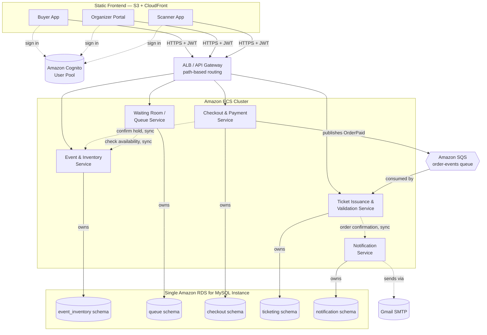

---

## Design decisions

**One database, five schemas, no cross-schema foreign keys.** A single Amazon RDS for MySQL instance hosts `event_inventory`, `queue`, `checkout`, `ticketing`, and `notification` — one per service — instead of five separate RDS instances, which keeps the school project's AWS bill and ops surface small. Each service's own tables carry real, enforced foreign keys. A reference to another service's row (e.g. `checkout.orders.event_id`) is stored as a plain unconstrained column instead, so the services stay logically independent and could be split onto separate instances later with zero schema change.

**Only one thing has to be synchronous: not overselling.** The one failure OneStage cannot tolerate is two buyers being confirmed for the same seat. So reserving and confirming an `InventoryHold` happens inside the Event & Inventory Service under a DB transaction, and Checkout calls `POST /holds/{id}/confirm` synchronously before it will mark an order `PAID` — if that call fails, the sale fails. Ticket generation and the confirmation email are not on that critical path, so Checkout instead publishes `OrderPaid` to the `order-events` SQS queue and Ticket Issuance consumes it asynchronously. That's the proposal's "event bus that decouples inventory and order events from downstream processing," scoped to the one hand-off where eventual consistency is actually fine.

**Authorization rides on one small table, not another service.** Cognito authenticates every request, but Organiser/Helper are per-event roles that don't map onto global Cognito groups. `event_team_memberships` in the Event & Inventory schema is the single source of truth: creating an event auto-inserts its creator as an accepted `ORGANISER`; an invitation creates a `PENDING` membership for the invitee's Cognito `sub`, with `granted_by_sub` set to the event owner's `organiser_sub`. Every organiser-or-helper-scoped endpoint in any service checks membership synchronously. Every other endpoint just requires a valid Cognito JWT — any signed-in user is a Customer by default.

**The confirmation email is its own service, one email per ticket, idempotent per ticket.** After Ticket Issuance creates the ticket rows for a paid order, it calls the Notification Service's `POST /notifications/order-confirmation` with the order's tickets, rather than sending mail itself. The Notification Service sends one email per ticket — each carrying only that ticket's QR code — and records one `email_notifications` row per ticket, so a booking of three tickets is three emails and three rows. Ticket Issuance does not wait on that call: sending mail takes seconds and must not slow the payment path, and the Notification Service records each ticket's `SENT`/`FAILED` outcome itself. It's idempotent on `ticket_id` — a unique key on `email_notifications` — so a retried call can never double-email a customer: tickets already `SENT` are skipped, and only tickets that are missing or `FAILED` are (re)sent. A delivery failure is recorded as `FAILED` and returned with a 201, not thrown back as an error: the order is already paid and the tickets already exist, so a bad SMTP credential degrades to "no confirmation email" instead of blocking or reversing the sale.

**What's deliberately left out.** Cognito's own login/token-refresh flow, network firewalls and WAF rules, a service mesh, and rate limiting beyond the waiting room's own admission control are all out of scope. IDs below are plain auto-increment `BIGINT`s rather than UUIDs, and every "email" field is a denormalized snapshot taken from the Cognito JWT at write time, so no service has to call another just to render a name.

---

## Event & Inventory Service — `event_inventory` schema

The platform's core technical risk: owns events, their inventory (GA quantity or a seat map), event-team roles, and the concurrency-safe hold that guarantees a seat or quantity is never sold twice.

### Data model

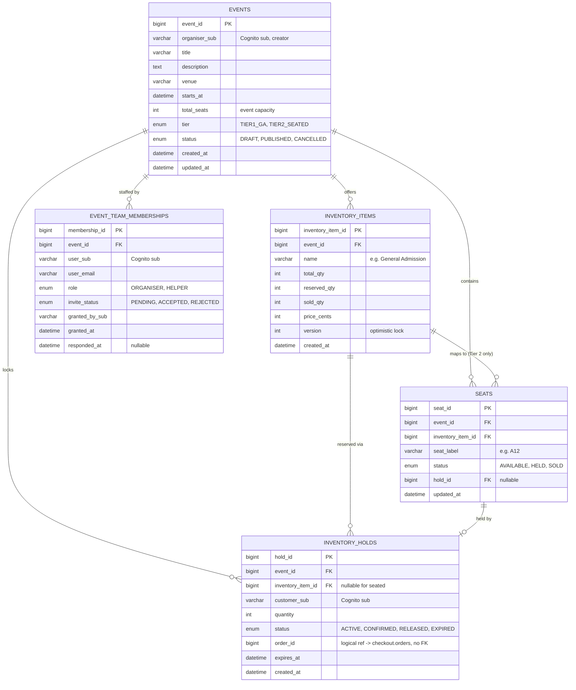

### Domain model

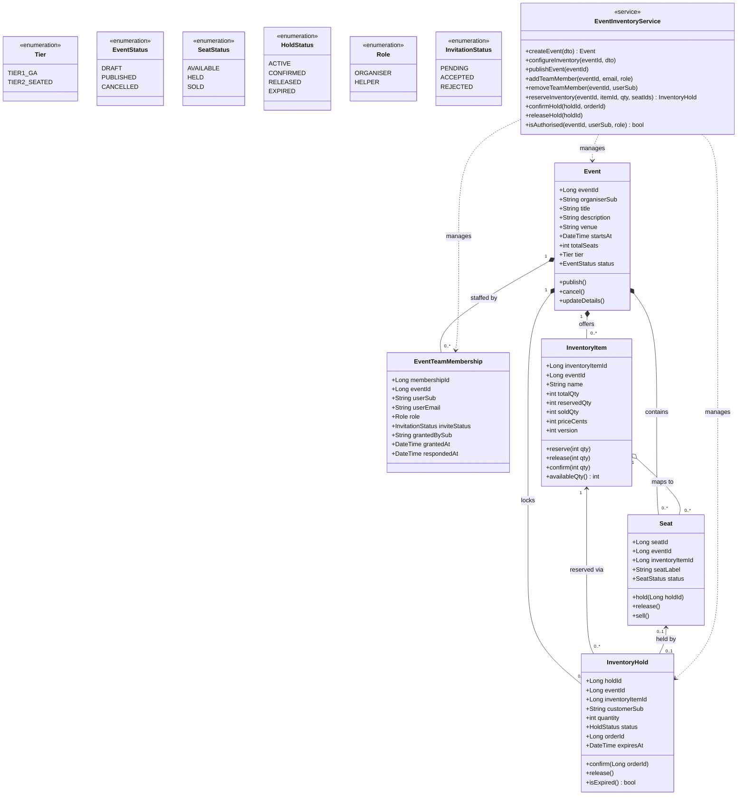

### API endpoints

| Method | Path | Description | Caller |
|---|---|---|---|
| POST | `/events` | Create a draft event (creator becomes Organiser) | Customer |
| GET | `/events` | Browse / search published events | Any |
| GET | `/events/{eventId}` | Event detail incl. live availability | Any |
| PUT | `/events/{eventId}` | Edit event details | Organiser |
| POST | `/events/{eventId}/publish` | Publish the event | Organiser |
| POST | `/events/{eventId}/cancel` | Cancel the event | Organiser |
| PUT | `/events/{eventId}/inventory` | Configure ticket quantity / seat map | Organiser |
| GET | `/events/{eventId}/seats` | Seat map with live status | Any |
| POST | `/events/{eventId}/invitations` | Create a pending invitation by email as Organiser or Helper | Organiser |
| POST | `/team-invitations/{membershipId}/accept` | Accept the caller's pending invitation | Invited user |
| POST | `/team-invitations/{membershipId}/reject` | Reject the caller's pending invitation | Invited user |
| GET | `/team-invitations` | List the caller's pending invitations | Signed-in user |
| GET | `/events/{eventId}/team-members` | View the event's team roster | Organiser / Helper |
| PATCH | `/events/{eventId}/team-members/{userSub}` | Change a member's role | Organiser |
| DELETE | `/events/{eventId}/team-members/{userSub}` | Remove a member | Organiser |
| GET | `/events/{eventId}/team-members/{userSub}` | AuthZ check: does user hold role X (internal) | Service-to-service |
| POST | `/events/{eventId}/inventory/hold` | Reserve seats / quantity (soft lock) | Customer |
| POST | `/holds/{holdId}/release` | Release a hold | Customer / internal sweep |
| POST | `/holds/{holdId}/confirm` | Confirm a hold as sold (sync, no-oversell path) | Checkout Service |

---

### Schema installation and upgrades

For a new database, run `02-init-create-tables-index.sql`. It creates `events.total_seats` and the invitation lifecycle columns and index on `event_team_memberships`.

For an existing schema created before these fields were introduced, run the migrations once in order:

1. `03-add-event-team-invitations.sql` adds `invite_status`, nullable `responded_at`, and the `(user_sub, invite_status)` lookup index used for a user's inbox.
2. `04-add-event-total-seats.sql` adds the required event-capacity column with a default of `1` for existing rows.

`total_seats` is configured capacity on `events`; `inventory_items.total_qty`, `reserved_qty`, and `sold_qty` remain the operational quantities used to calculate currently available inventory.

On AWS, `05-grant-onestage-app-schema-access.sql` is also required once per MySQL instance — the ECS-hosted MySQL container only grants the app user access to its own `onestage` database on creation, not to any of the four schemas above. See `infrastructure/sql/QUICK-START.md`.

---

## Waiting Room / Queue Service — `queue` schema

Sits in front of Tier 2 on-sales only. Holds no inventory of its own — it just orders customers into a line and admits them in batches, checking availability against the Event & Inventory Service before letting anyone through.

### Data model

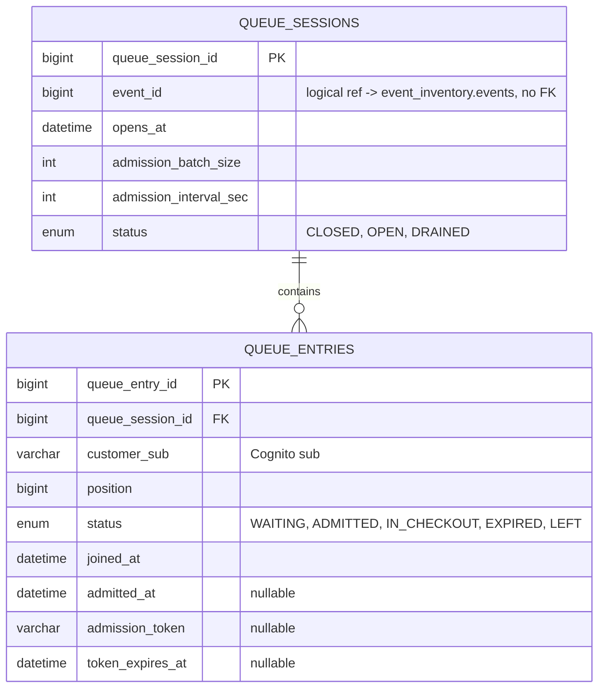

### Domain model

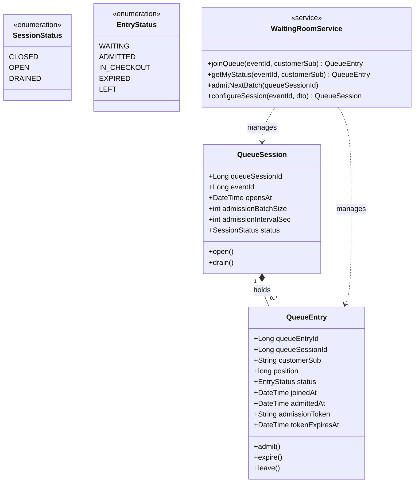

### API endpoints

| Method | Path | Description | Caller |
|---|---|---|---|
| PUT | `/events/{eventId}/queue/config` | Configure on-sale time & admission rate | Organiser |
| POST | `/events/{eventId}/queue/join` | Join the waiting room | Customer |
| GET | `/events/{eventId}/queue/me` | My live position & status | Customer |
| POST | `/events/{eventId}/queue/admit-next` | Admit the next batch (scheduled) | Internal (scheduled task) |

---

## Checkout & Payment Service — `checkout` schema

Turns a confirmed hold into a paid order using a simulated, tokenized payment — no real card data ever reaches this schema. Owns the sales figures and attendee contact details organisers see on their dashboard.

### Data model

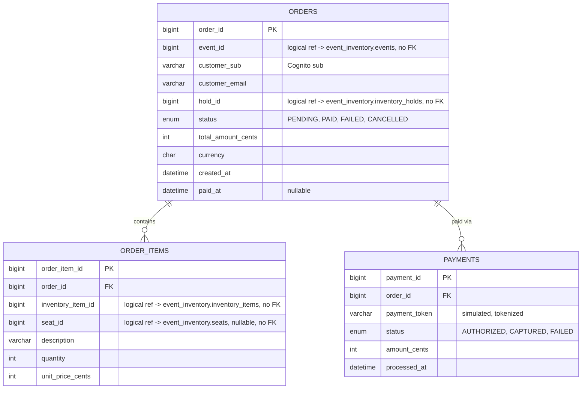

### Domain model

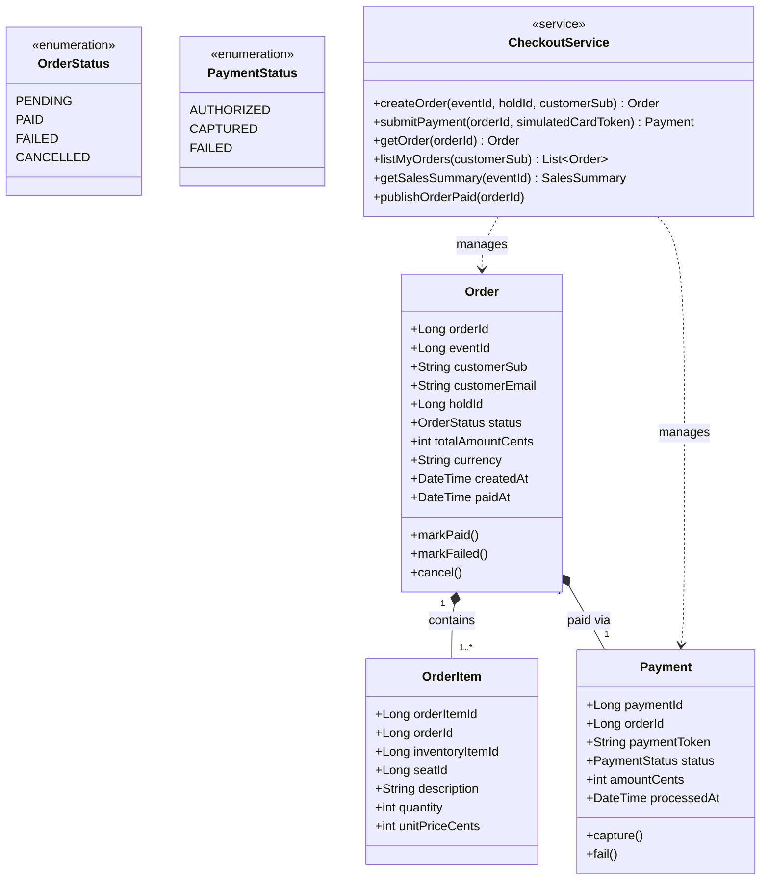

### API endpoints

| Method | Path | Description | Caller |
|---|---|---|---|
| POST | `/orders` | Create an order from a hold | Customer |
| POST | `/orders/{orderId}/payment` | Submit simulated, tokenized payment | Customer |
| GET | `/orders/{orderId}` | Order detail | Customer (owner) / Organiser |
| GET | `/customers/me/orders` | My order history | Customer |
| GET | `/events/{eventId}/orders/summary` | Sales dashboard data | Organiser / Helper |
| GET | `/events/{eventId}/attendees` | Attendee & order export | Organiser |

---

## Ticket Issuance & Validation Service — `ticketing` schema

Issues the QR-coded ticket after payment and is the single source of truth at the door: the Scanner App and the Buyer App's own "my tickets" view both read ticket state from here, so a ticket can never be checked in twice.

### Data model

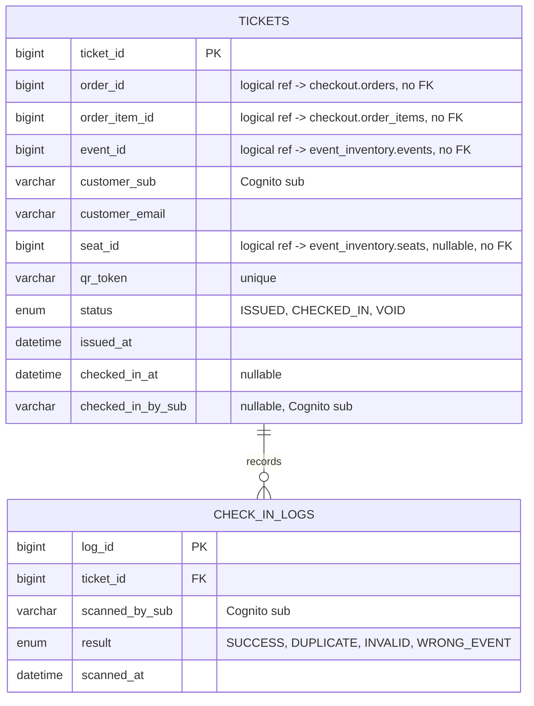

### Domain model

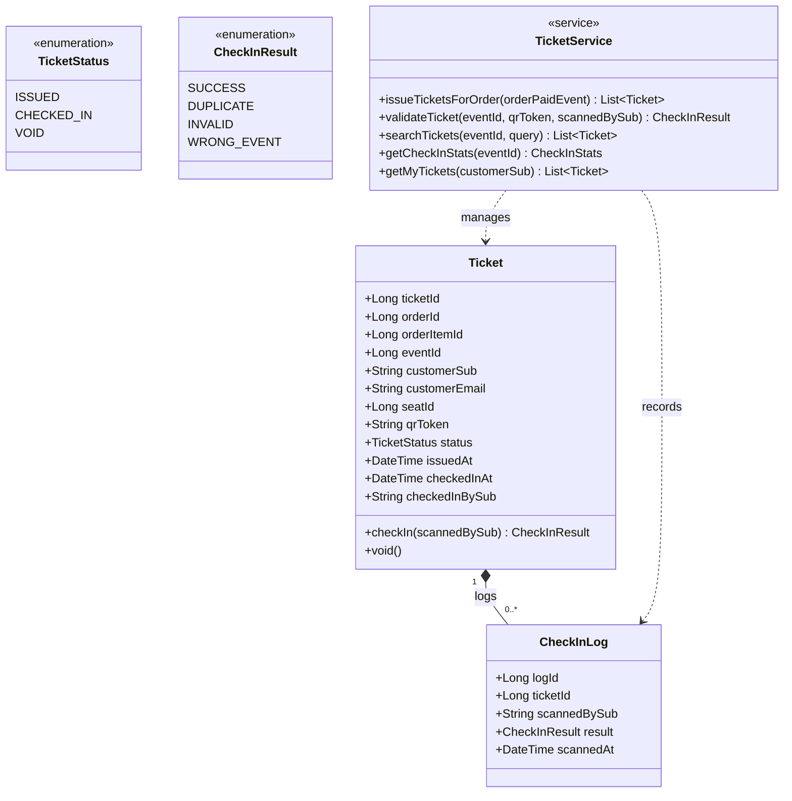

### API endpoints

| Method | Path | Description | Caller |
|---|---|---|---|
| GET | `/customers/me/tickets` | My tickets | Customer |
| GET | `/tickets/{ticketId}` | Ticket detail + QR | Customer (owner) |
| POST | `/tickets/validate` | Scan & validate a QR code | Helper / Organiser |
| GET | `/tickets/search` | Manual lookup by name / email / order ID | Helper / Organiser |
| GET | `/events/{eventId}/checkin-stats` | Live check-in count | Organiser / Helper |
| *(async)* | SQS `order-events` → `OrderPaid` | Consumer: issues ticket(s), then calls Notification Service | System |

---

## Notification Service — `notification` schema

Sends one confirmation email per issued ticket (event name, location, date/time, and that ticket's QR code) once Ticket Issuance has created the tickets for a paid order. It owns no inventory or money state — just the record of what was sent, to whom, and whether it succeeded — and delivers over Gmail SMTP via nodemailer.

### Data model

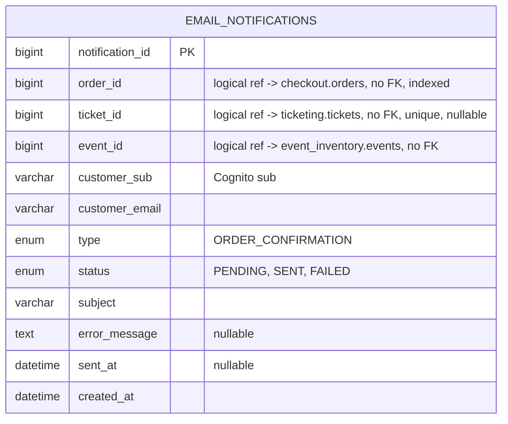

`ticket_id` carries a unique key, not just an index — it's what makes the send idempotent. A second call for the same ticket updates the existing row (`ON DUPLICATE KEY UPDATE`) instead of inserting a duplicate, while `order_id` is a plain index so one order can hold several rows. `ticket_id` is nullable only for rows written before per-ticket emails; MySQL allows any number of `NULL`s under a unique key. Apply `15-email-notifications-per-ticket.sql` to move an existing database to this shape.

### Domain model

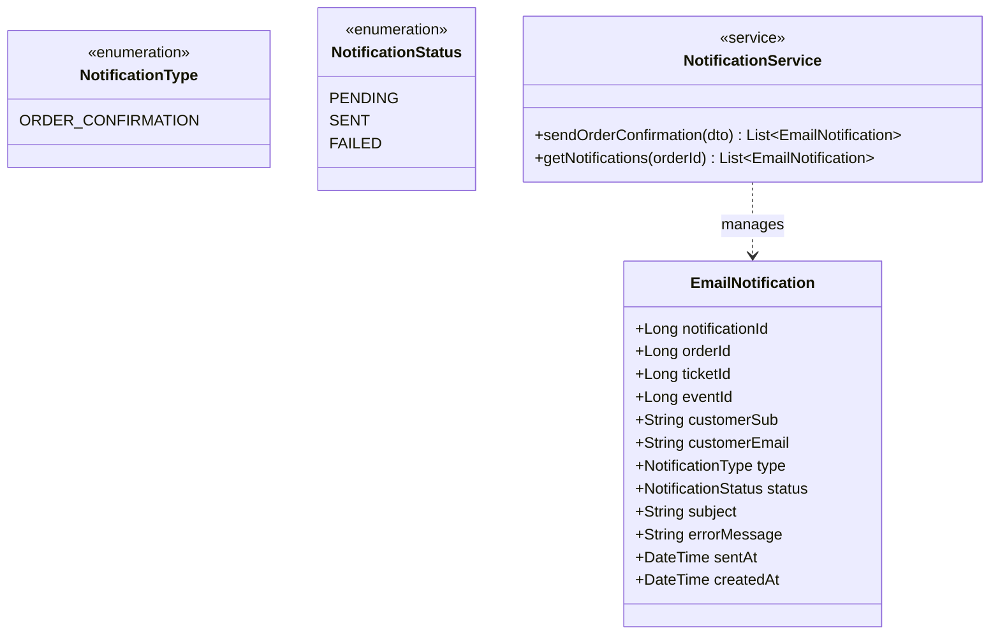

### API endpoints

| Method | Path | Description | Caller |
|---|---|---|---|
| POST | `/notifications/order-confirmation` | Send one confirmation email per ticket in the order and record one `email_notifications` row per ticket; idempotent on `ticketId` — tickets already `SENT` are skipped. Responds `{ orderId, notifications: [...] }`: 201 if any email was attempted, 200 if every ticket was already `SENT` | Ticket Issuance & Validation Service |
| GET | `/notifications/{orderId}` | Look up the send outcome (status, error, timestamps) of every ticket email for an order, for support/ops diagnosis; 404 if none | Not yet called by another service — read-only diagnostic route |

### Schema installation

Run `06-add-notification-schema.sql` once, in addition to `02-init-create-tables-index.sql`; it creates the `notification` database and the `email_notifications` table (`CREATE ... IF NOT EXISTS`, so it's safe to re-run). Afterward, re-run `05-grant-onestage-app-schema-access.sql` so `onestage_app` can reach the new schema too. On a database created before per-ticket emails, also run `15-email-notifications-per-ticket.sql` once (it checks `information_schema` first, so it's safe to re-run); it adds `ticket_id`, makes it the unique key, and demotes `order_id` to a plain index. The Notification Service needs it: its per-ticket queries fail with `Unknown column 'ticket_id'` until it has been applied.

---

## Tier 2 purchase — sync vs. async in one picture

The flow that justifies every choice above: the queue and the inventory hold are synchronous because correctness can't wait; publishing to SQS and issuing the ticket happen after the customer already has a confirmed, paid order.

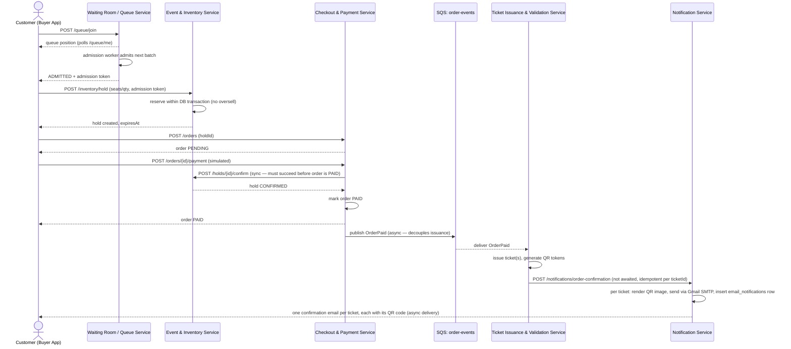

A Tier 1 purchase runs the same path with the Waiting Room steps skipped entirely — `POST /inventory/hold` succeeds immediately since there's no queue to admit from.

---

*Companion document to "OneStage — User Stories & Use-Case Diagrams." IDs, enum values, and endpoint names here are the vocabulary the user stories' acceptance criteria assume — e.g. CU-09's "no seat is ever confirmed to two buyers" is exactly what `InventoryHold` plus the synchronous `/holds/{id}/confirm` call is designed to guarantee.*
